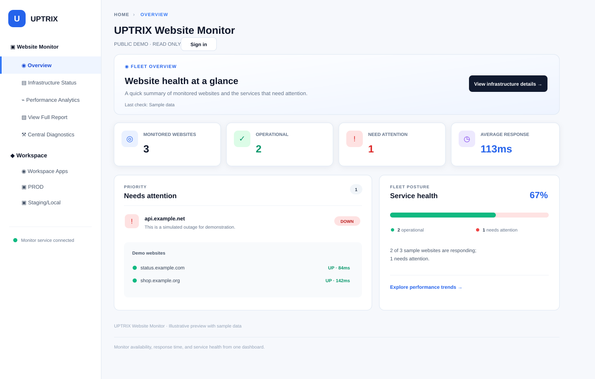

# UPTRIX Website Monitor

UPTRIX monitors website availability, response time, TLS certificate expiry, and recent check history. The web dashboard provides a fleet overview, detailed infrastructure status, analytics, reports, and per-website workspace cards.



## Run locally (Windows PowerShell)

1. Install Python 3.10 or newer.
2. From this repository folder, create an environment and install dependencies:

   ```powershell
   python -m venv .venv
   .\.venv\Scripts\Activate.ps1
   python -m pip install -r requirements.txt
   ```

3. Create the initial administrator account. Enter a private password when prompted; it is not stored in this repository:

   ```powershell
   $env:UPTRIX_BOOTSTRAP_ADMIN_USERNAME = Read-Host "Admin username"
   $securePassword = Read-Host "Admin password (12+ characters)" -AsSecureString
   $env:UPTRIX_BOOTSTRAP_ADMIN_PASSWORD = [System.Net.NetworkCredential]::new("", $securePassword).Password
   python .\backend\init_rbac.py
   Remove-Item Env:UPTRIX_BOOTSTRAP_ADMIN_USERNAME, Env:UPTRIX_BOOTSTRAP_ADMIN_PASSWORD
   Remove-Variable securePassword
   ```

4. Start the monitor:

   ```powershell
   python .\backend\multi_status_service.py
   ```

5. Open <http://127.0.0.1:5174>.

The service checks monitored sites from the machine where the backend runs. Allow it outbound access to the websites over HTTP/HTTPS. The public demo uses fixed sample data and does not make live requests.

## Access roles

- **Guest:** fixed, read-only demo data.
- **Viewer:** read-only access to live monitoring data.
- **Operator:** view data and add websites.
- **Admin:** full website and user management.

There are no default credentials. Bootstrap or reset accounts using the documented scripts and private environment variables. Set a stable `JWT_SECRET_KEY` environment variable for deployments so sessions remain valid across restarts.

## Local data and secrets

The service creates its SQLite database, monitored-domain list, and monitoring history under `backend/` at runtime. These files are excluded from Git because they can contain account hashes, private site lists, and operational data. Never commit passwords, API keys, session tokens, or production database files.

## Project files

- `backend/multi_status_service.py` — FastAPI website-monitor service and API.
- `backend/multi_static/` — dashboard and report UI.
- `backend/models.py` and `backend/database.py` — local persistence and account models.
- `backend/init_rbac.py` — database initialization and optional first administrator setup.
- `backend/reset_user_password.py` — secure local account password reset helper.
